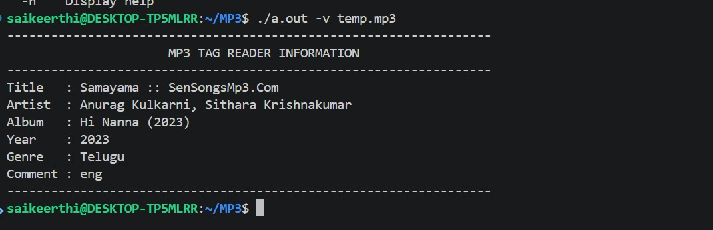
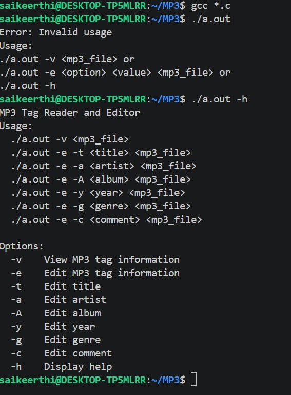
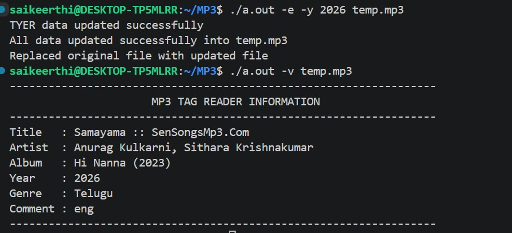
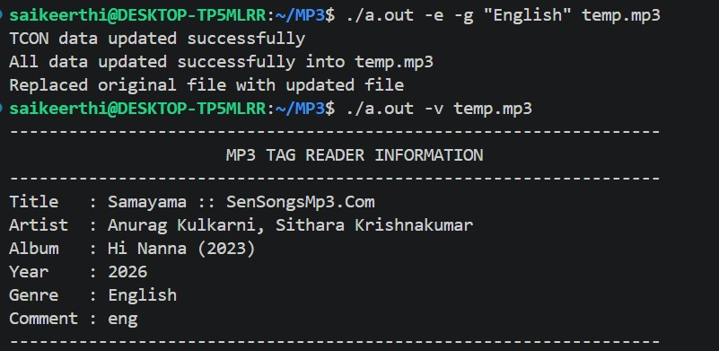
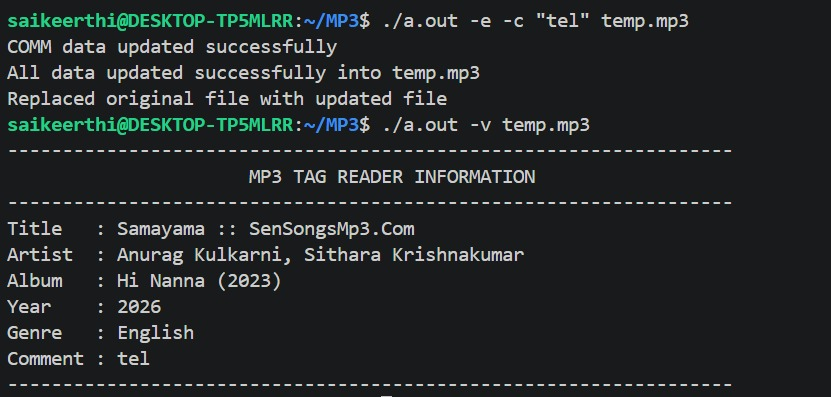

# 🎵 MP3 Tag Reader & Editor

A command-line based **MP3 Tag Reader and Editor** developed using C programming. This project reads and modifies ID3v2.3 metadata stored inside MP3 files using file handling, string manipulation, command-line arguments, dynamic memory allocation, pointers, and bitwise operations.

## 📌 Project Overview

MP3 files contain metadata that provides information about the audio file, such as:

- 🎵 Title
- 👤 Artist
- 💿 Album
- 📅 Year
- 🎼 Genre
- 💬 Comment

This application allows users to view existing MP3 tag information and edit individual metadata fields directly through the terminal.

The project processes MP3 files in binary mode and works with ID3 frame headers and frame data.

## ✨ Features

### 📖 1. View MP3 Tags

Displays the metadata stored in an MP3 file.

**Command:**

```bash
./a.out -v <mp3_file>
```

**Example:**

```bash
./a.out -v temp.mp3
```

The application displays:

- Title
- Artist
- Album
- Year
- Comment
- Genre

### ✏️ 2. Edit MP3 Tags

The application supports editing the following ID3v2.3 metadata frames:

| Option | ID3 Frame | Description |
|---|---|---|
| `-t` | TIT2 | Edit Title |
| `-a` | TPE1 | Edit Artist |
| `-A` | TALB | Edit Album |
| `-y` | TYER | Edit Year |
| `-g` | TCON | Edit Genre |
| `-c` | COMM | Edit Comment |

**Editing Examples:**

Edit Title:

```bash
./a.out -e -t "Manohari" temp.mp3
```

Edit Artist:

```bash
./a.out -e -a "Mohana Bhogaraju, Revanth" temp.mp3
```

Edit Album:

```bash
./a.out -e -A "Baahubali - The Beginning" temp.mp3
```

Edit Year:

```bash
./a.out -e -y 2015 temp.mp3
```

Edit Genre:

```bash
./a.out -e -g "Telugu Film Music" temp.mp3
```

Edit Comment:

```bash
./a.out -e -c "Baahubali - The Beginning" temp.mp3
```

### 🆘 3. Help Menu

Displays available commands and usage instructions.

**Command:**

```bash
./a.out -h
```

## 🛠️ Technologies Used

- C Programming
- GCC Compiler
- File Handling
- Binary File Processing
- Command-Line Arguments
- String Manipulation
- Dynamic Memory Allocation
- Pointers
- Bitwise Operations
- ID3v2.3 Metadata

## 🧠 C Programming Concepts Used

### 1. File Handling

Used file handling functions to read and modify MP3 binary data.

Functions used:

- `fopen()`
- `fread()`
- `fwrite()`
- `fseek()`
- `ftell()`
- `fclose()`
- `remove()`
- `rename()`

### 2. Command-Line Arguments

Used command-line arguments to process user commands through the terminal.

```c
int main(int argc, char *argv[])
```

The program identifies the operation and editing option based on the arguments supplied by the user.

### 3. Bitwise Operations

Used bitwise operations and byte manipulation while processing metadata sizes.

### 4. Endian Conversion

Implemented a custom function to reverse the byte order of an integer while processing frame sizes.

```c
void convert_endians(int *s)
{
    int i = 0, j = sizeof(*s) - 1;
    char *ptr = (char *)s;
    char temp;

    while (i < j)
    {
        temp = ptr[i];
        ptr[i] = ptr[j];
        ptr[j] = temp;
        i++;
        j--;
    }
}
```

### 5. Dynamic Memory Allocation

Used dynamic memory allocation to allocate memory for frame data based on its size.

```c
data = malloc(size);
```

Also used `realloc()` when updating frame data.

### 6. Pointers and String Manipulation

Used pointers and string functions such as:

- `strcmp()`
- `strcpy()`
- `strlen()`

These functions help identify metadata frames and update their contents.

### 7. Binary File Processing

Worked with MP3 files in binary mode (`rb` and `wb`) to read headers, identify frames, modify metadata, and write updated information.

## 🏗️ Project Structure

```text
MP3_Tag_Reader_and_Editor/
│
├── main.c
├── view.c
├── edit.c
├── fun.h
│
├── outputs/
│   ├── Comment_edited.jpeg
│   ├── Genre_edited.jpeg
│   ├── help_display.jpeg
│   ├── view_output.jpeg
│   └── year_edited.jpeg
│
└── README.md
```

### File Descriptions

| File | Description |
|---|---|
| `main.c` | Main function and command-line argument handling |
| `view.c` | Reads and displays MP3 tag information |
| `edit.c` | Updates MP3 metadata |
| `fun.h` | Function declarations and endian conversion function |
| `outputs/` | Project execution screenshots |

## 🏗️ ID3v2.3 Frame Structure

The project works with ID3v2.3 metadata frames.

Each frame contains:

```text
+----------------------+
| Frame ID   - 4 bytes |
+----------------------+
| Size       - 4 bytes |
+----------------------+
| Flags      - 2 bytes |
+----------------------+
| Frame Data           |
+----------------------+
```

### Common ID3 Frame Identifiers

| Frame ID | Metadata |
|---|---|
| TIT2 | Title |
| TPE1 | Artist |
| TALB | Album |
| TYER | Year |
| TCON | Genre |
| COMM | Comment |

## 🔄 How Editing Works

The editing process follows these steps:

1. Open the original MP3 file in binary read mode.
2. Create an intermediate file named `temp1.mp3`.
3. Read and copy the 10-byte ID3 header.
4. Read the existing frame ID and frame size.
5. Convert the frame size into the required byte order.
6. Identify the frame that needs to be modified.
7. Allocate memory for the new frame data.
8. Write the updated frame into the intermediate file.
9. Copy the remaining MP3 data.
10. Close both files.
11. Remove the original file and rename `temp1.mp3` to the original filename.

This process updates the selected metadata frame while preserving the remaining file data.

## 🚀 Build and Run

### Step 1: Clone the Repository

```bash
git clone https://github.com/Saikeerthi14/MP3_Tag_Reader_and_Editor.git
```

### Step 2: Navigate to the Project Directory

```bash
cd MP3_Tag_Reader_and_Editor
```

### Step 3: Compile the Program

```bash
gcc main.c view.c edit.c -o mp3tag
```

### Step 4: Run the Application

View MP3 tags:

```bash
./mp3tag -v temp.mp3
```

Display help:

```bash
./mp3tag -h
```

Edit metadata:

```bash
./mp3tag -e -t "Manohari" temp.mp3
```

**Note:** Provide your own MP3 file containing compatible ID3v2.3 metadata. The executable name `mp3tag` is used here instead of `a.out`.

## 📸 Project Outputs

### 1. View MP3 Tags

Displays the existing metadata information stored in an MP3 file.



### 2. Help Menu

Displays the available commands and usage instructions.



### 3. Edit Year

Demonstrates updating the year metadata of an MP3 file.



### 4. Edit Genre

Demonstrates modifying the genre information.



### 5. Edit Comment

Demonstrates updating the comment metadata of an MP3 file.



## 📚 Learning Outcomes

Through this project, I gained practical experience in:

- Reading and writing binary files.
- Understanding MP3 ID3v2.3 metadata.
- Working with frame headers and frame data.
- Handling command-line arguments.
- Using file pointers and random file access.
- Implementing dynamic memory allocation.
- Working with pointers and string manipulation.
- Understanding endian conversion.
- Using bitwise operations.
- Developing modular C applications.
- Debugging binary file-processing applications.

## 🔮 Future Enhancements

- Improve ID3 tag size handling.
- Improve handling of COMM frame structure.
- Support additional ID3 frames.
- Support ID3v1 metadata.
- Add album artwork support.
- Improve error handling and input validation.
- Add support for more MP3 metadata fields.
- Perform cross-platform testing.

## 👨‍💻 Author

**Sai Keerthi**

Electronics and Communication Engineering

GitHub: [Sai Keerthi](https://github.com/Saikeerthi14)

**Project Repository:** [MP3 Tag Reader & Editor](https://github.com/Saikeerthi14/MP3_Tag_Reader_and_Editor)

---

⭐ If you find this project useful for learning C programming, binary file handling, and MP3 metadata processing, feel free to explore the repository and share your feedback!
